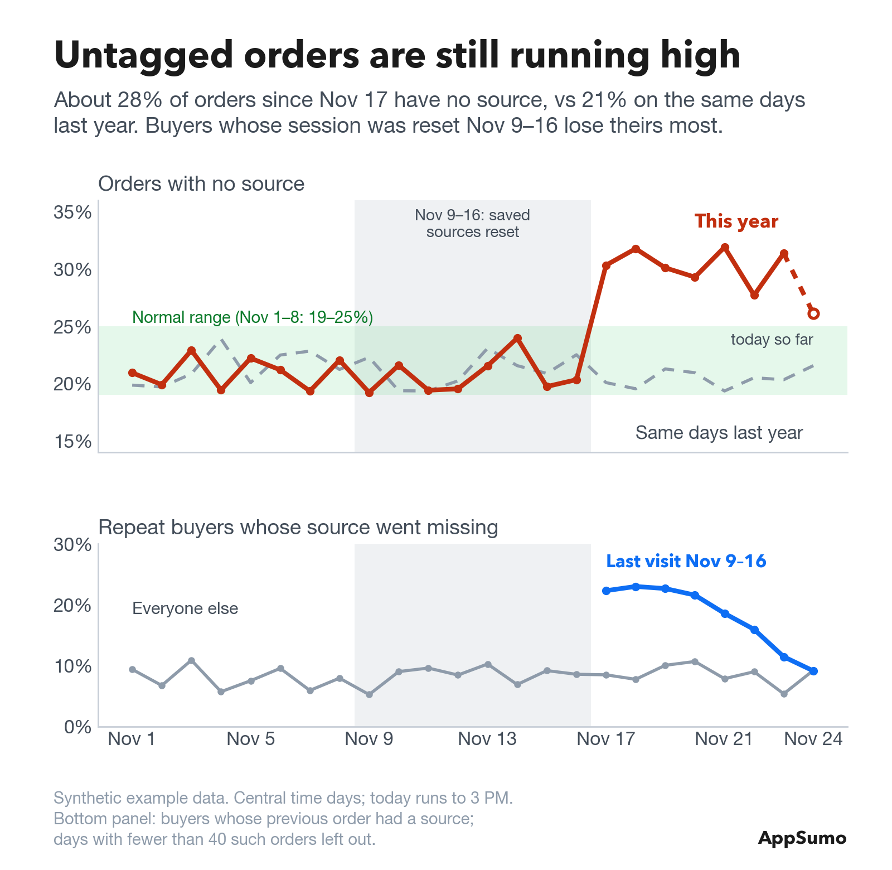

# metric-charts

A Claude Code plugin. When Claude shares numbers with people, especially in Slack, it sends one or
two charts that each make one point instead of a wall of numbers:

- a title that states the conclusion, and a subtitle with the key numbers;
- the honest caveats on the image itself: source, date range, timezone, small samples, confounders;
- context for every bump: last year as a dashed line, a normal-range band, shaded incident windows,
  weekends, and event lines;
- direct labels instead of legends, phone-readable sizes, 1600 px wide;
- a short message in your own voice with the chart attached, posted as you in one Slack message.



How Claude runs it: `skills/metric-charts/SKILL.md`.

## Parts
- `skills/metric-charts/SKILL.md` and `references/examples.md`: when to chart, the process, chart
  rules, and delivery.
- `lib/chart_kit.py`: matplotlib helpers (`one_panel`, `two_panel`, `header`, `foot`, `line`,
  `partial_last_point`, `bars`, `band`, `window`, `event_line`, `shade_weekends`, `direct_label`,
  axis formatters, `save`) and themes (`neutral`, `appsumo`, or your own via `register_theme`).
- `lib/examples/`: two worked examples on synthetic data.
- `lib/slack_upload.py`: posts text plus files as one Slack message.
- `bin/metric-charts`: `lib` (print the kit path), `examples <out> [theme]`, `upload ...`.
- `assets/`: rendered examples.

## Requirements
- Python 3 with matplotlib.
- For `upload`: a Slack MCP server entry named `slack` in `~/.claude.json` whose `env` holds a
  user token (and cookie, for browser tokens). The script reads them from there and never prints
  them. Without it, attach the PNG by hand.

## Install
```
/plugin marketplace add <owner>/claude-metric-charts
/plugin install metric-charts@metric-charts
```

## License
MIT
